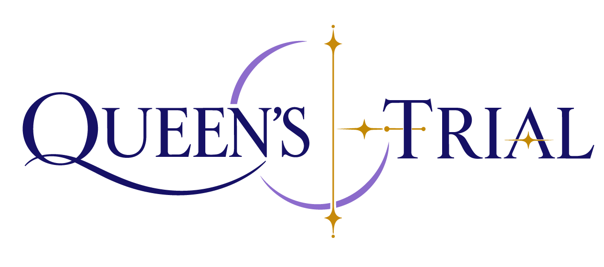
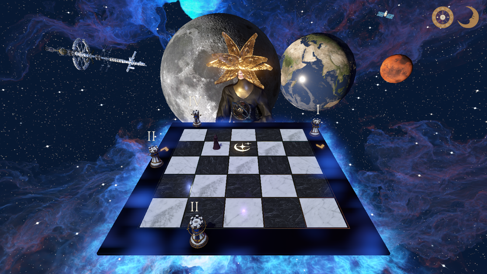
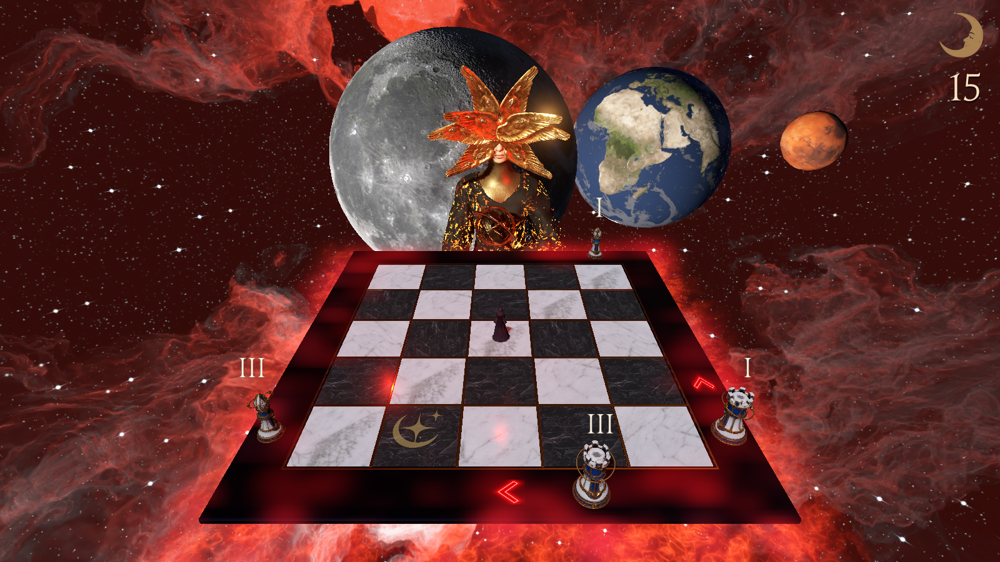

  

Puzzle 3D · Fantasia · Matemática · Windows

 

## SOBRE O PROJETO

Entre mundos, uma Rainha guarda a passagem. Para atravessá-la, o Viajante precisa compreender seus éditos e encontrar um caminho seguro pelo tabuleiro.

**Queen's Trial** é um jogo de raciocínio em que números romanos indicam como se mover. Observar os ataques das peças, interpretar as cartas e planejar cada deslocamento fazem parte da mesma decisão: onde parar para sobreviver à próxima rodada.

O projeto nasceu no curso de Engenharia de Software da Católica de Santa Catarina, com uma proposta de aprendizagem de números romanos e matemática para o ensino fundamental. Essa ideia ganhou uma aventura com identidade astral, narrativa ilustrada e desafios que apresentam as regras aos poucos.

## A EXPERIÊNCIA

- **Aprender explorando:** um mapa animado apresenta os números romanos de I a XX, acompanhado por constelações. Durante a campanha, ele também serve como consulta.
- **Planejar antes de agir:** em um tabuleiro 5 × 5, os éditos definem a distância dos movimentos, enquanto torres e bispos ameaçam linhas e diagonais.
- **Mudar de raciocínio:** a campanha reúne 12 fases, com desafios de movimento, comparação de pesos, ordenação de cartas e identificação de éditos falsos.
- **Ir além da campanha:** o modo opcional **Chaotic** acrescenta cinco desafios, operações de subtração e divisão, cartas que desaparecem e tempo limitado para escolher a posição inicial.

<table>
  <tr>
    <td width="50%">
      
    </td>
    <td width="50%">
      
    </td>
  </tr>
  <tr>
    <td align="center">Campanha principal</td>
    <td align="center">Simulação Chaotic</td>
  </tr>
</table>

## DESENVOLVIMENTO

Trabalhei na programação das mecânicas e da interface, na construção das cenas e no acabamento audiovisual. O processo envolveu ajustar o ritmo dos desafios, tornar as instruções mais claras e integrar narrativa, animações, iluminação e efeitos ao que acontece no tabuleiro.

O jogo foi desenvolvido em **Godot 4, com GDScript**. Usei **Blender** na modelagem do tabuleiro e das peças, e ferramentas da **Adobe**, incluindo **Substance 3D Painter** para texturização e **Mixamo** para animações. A composição visual combina esses elementos com recursos de terceiros, adaptados e integrados ao projeto.

Também trabalhei no desempenho para computadores com vídeo integrado, com ajustes nos modelos e efeitos e adaptação automática da resolução do cenário 3D, preservando a nitidez da interface.

## COMO JOGAR

[**Baixar para Windows**](../../releases/latest/download/Queens-Trial-Windows.zip)

A versão para Windows funciona como uma aplicação independente: basta extrair a pasta do jogo e abrir o executável. Não é necessário instalar o Godot para jogar.

| Ação | Controle |
| --- | --- |
| Mover o Viajante | **W, A, S, D** |
| Virar cartas e páginas, selecionar opções | **Mouse** |
| Confirmar a posição inicial | **Enter** |
| Abrir as instruções | **N** ou ícone da lua |
| Consultar os números romanos na campanha | **M** ou ícone do zodíaco |
| Pausar | **Esc** |

Para explorar o projeto no editor, clone o repositório com **Git LFS** habilitado e importe o arquivo [`project.godot`](project.godot) no Godot **4.7.2**, versão utilizada no desenvolvimento.

## CRÉDITOS

As atribuições de modelos, músicas, fontes, ilustrações e demais recursos estão em [Créditos e licenças](CREDITS.md).
